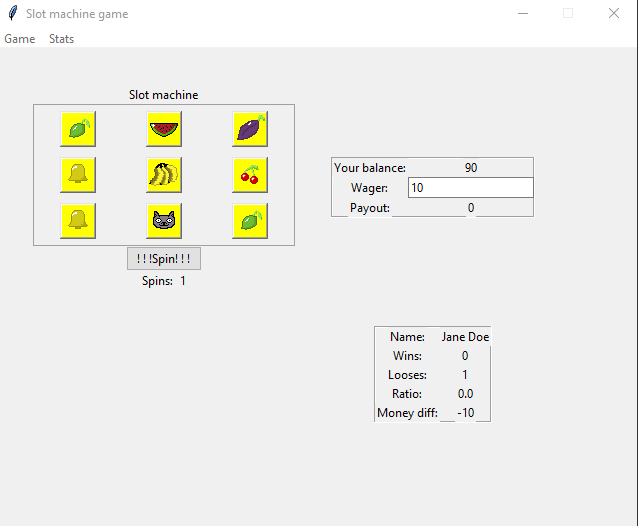
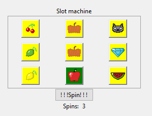
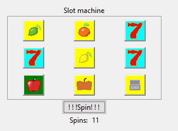
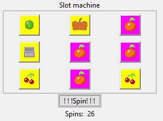
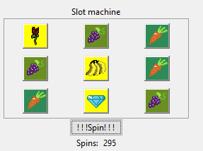
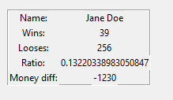
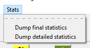

# Spinner
A cross platform slots playing game with tkinter front end integration.

## Building
This project was meant to be run on as few dependencies as possible. Currently the only requirements are:
- Pillow
This can be easily installed via:
```
pip install -r requirements.txt
```
**NOTICE**: It is highly advisable to not install any Python requirements before setting up virtual environment.

The _Pillow_ dependency is used for image displaying only. _Pillow_ allows the compiler to interpret image representations. For more check here: [Pillow](https://pillow.readthedocs.io/en/stable/)

After installing dependencies proceed to launch the game with:
```
$ python main.py
```
## Concept
In general this game was created to help my friend get to know Python a little better, enabling him to implement more complex mathemtacial prinicples into it without polluting his mind with less-mathematical concepts of programming. However solution to this game was made by me for the time being. You can learn about slot randomness later on.


### Main screeen


The game consists of a very solid concept, player gets money at start, they can modify their wager and spin the wheel of greed, hoping for winning this round. We can find some information regarding the game process (lower right corner), user balance and session related information (center to right), and slot machine (left).

### Slot generation
Each time player presses `!!!Spin!!!` button on the screen, the game triggers 9 independent `random.randint(1,19)` functions for each of the slots present on the screen. Each number will be later on replaced by the corresponding key slot sprite. Bare in mind that sprites are loaded once, during the game initialization. The machine then verifies two key factors:
1. Is any number/slot lucky?
2. Are there any number/slot repeated at least 3 times?


Should these conditions be met, the machine will change the slot background color from the default yellow into a fixed color for a lucky number or one random color out of predefined set of colours. These can be found inside `core/machine.py`.
```Python
    COLOR_PALLET = [
        "#00ffff",
        "#dc143c",
        "#ff00ff",
        "#00ff00",
        "#9370db",
        "#00008b",
        "#6b8e23",
        "#2e8b57"
    ]
```
If you're looking to modify them, this is the place to do that. Colors must be in a hex form.

#### Lucky Number

#### Three repeating numbers


Notice that, both lucky number and set of repeating numbers can appear, and they will indeed have different colours.
#### Four repeating numbers

#### Two sets of three repeating numbers


Notice that these sets has different colors! Grapes are `#6b8e23`, where as carrots are `#2e8b57`


### Prize calculation
User prize is calculated by mathematical formulas that can be found inside `core/machine.py`

To be brief here, each time a set of at least three repeating numbers is present, wager will be multiplied `x` times where `x` is the actual repeating number count, and then added to the current winning sum. However when a Lucky number is present (at least one), the entire win sum (during that iteration) will get multiplied by the amount of lucky number occurances + 1 (Meaning the winning sum will get at least doubled). There can be a situation where only Lucky number is present. In that case the machine would do the same mechanism as for the winning sum but with the wager.

After prize calculation, the player will get awarded and every slot color will get restarted into the deafult yellow value.

### Dumps and analysis
Since this was initially a mathematical project, rather than a programming one, some analysis would be required, for this there are two options present for the user.
`Ratio` information presented in lower right corner of the screen



Yet for more complex analysis some more information would be beneficial. Such information would include session info dumps (including current money the player has, current ratio, looses, wins etc.), for that purpose I've implemnted the `stats` menu with two possible options.



The difference between final and detailed statictics is simple. The detailed stats additionally hold information about:
- Total player wins 
- Total player looses 
- Total player difference
- Current (round-wise) player balance

Along with the basic information:
- Turn
- Wager
- Turn win

These dumps are done via the built-in `csvWriter` so no need for `Pandas` is required. If you wish to modify these behaviour to use `Pandas` you should be looking for changing type for `self.turn_snapshots` inside `core/game.py`. And change the underlying logic insied `_spin()` method inside that same file. I've done this in such way that there is as little dependencies as possible.

### Info regarding simulating
This simulation was done primarly as a fun little project, thus no automation was implemented, yet users who want to play around, can in fact enable automated simulation by changing the logic for `_spin()` method inside aforementioned `core/game.py` to make it inside never-ending loop.
#### Proposition never-ending loop
```Python
    def _spin(self, *args):
        while True:
            balance_numeric = self.player.balance.get()
            wager_numeric = self.wager.get()

            if balance_numeric < wager_numeric:
                return

            # Rest of the method
            self.turn_snapshots[self.machine.spin_count.get()] = (wager_numeric,
                                                                win,
                                                                self.player.total_won.get(),
                                                                self.player.total_lost.get(),
                                                                self.player.total_diff.get(),
                                                                self.player.balance.get())
```
Do until wager exceeds balance (outside of loop test).
#### Proposition conditioned loop
```Python
    def _spin(self, *args):
        for i in range(1, 100):
            balance_numeric = self.player.balance.get()
            wager_numeric = self.wager.get()

            # Rest of the method
            self.turn_snapshots[self.machine.spin_count.get()] = (wager_numeric,
                                                                win,
                                                                self.player.total_won.get(),
                                                                self.player.total_lost.get(),
                                                                self.player.total_diff.get(),
                                                                self.player.balance.get())
```
Do until 100 iteration has passed, no matter what the wager to balance ratio is.

However if the user decides to stick with the manual simulation there are some tricks that may come handy.

- `B` is a shortcut for `Game->Borrow money`
- `R` is a shortcut for `Game->Reset`

### Art
This project consists of 20 sprites which were made by me inside [Aseprite](https://www.aseprite.org/) which I highly recommend on using, as it is a great tool even for such amateur as me. You can find all sprites under `res/` folder.

Bare in mind that if you want to add or edit any sprites you must ensure that they are `32x32` as this was the desired resolution during the development. When adding and deleting don't forget to modify `helpers/symbol.py`.

```Python
SYMBOLS = [
    Symbol("res/Bannana-Sprite.png", 0, "Bannana"),
    # ...
    Symbol("res/Bell-Sprite.png", 19, "Bell"),
    Symbol("res/Symbol-file.png", 20, "Symbol Name")
]
```
As well as changing the `random.randint` range to also include your additional symbols!

## Potential future improvements
This code was made so that my friend could have some fun regarding mathematical code creation and manipulation, yet there was no code contributied towards it. Any future improvements that I may suggest would be to either prize calculation or slot generation.

## Credits
- John Peter Bielawa-Zając
- Jacob Gołąb